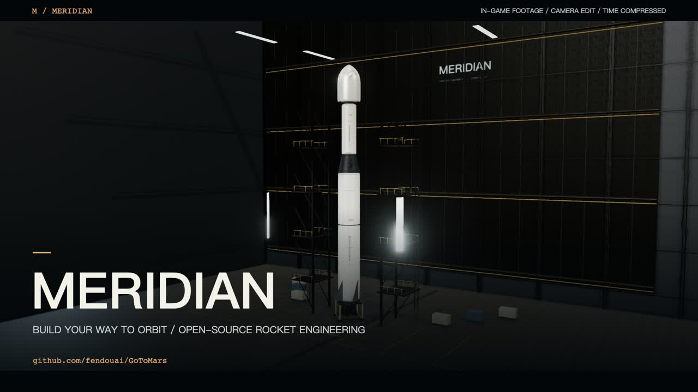
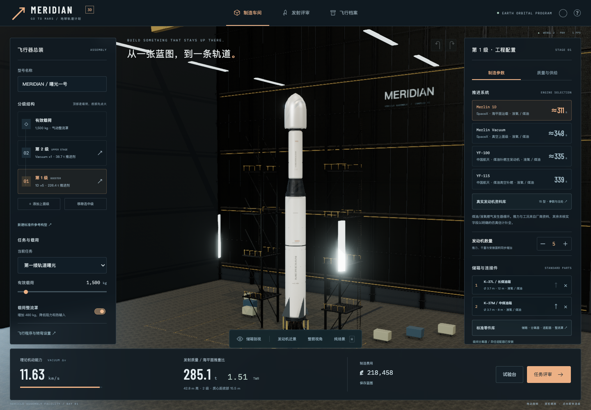

# MERIDIAN · 3D 地球轨道计划

当前版本：2.1（视觉基础升级）。新增真实 PBR 贴图、细化车间与发射塔、发动机近景、天空散射、天气云影、接触遮蔽与纯场景检视。说明与实际截图见 [docs/VISUAL_UPGRADE.md](docs/VISUAL_UPGRADE.md)。

Go To Mars 的 3D 重制版本。现在聚焦一件事：用可以组合的零件制造火箭，沿一条连续的三维轨迹从地面进入真实尺度地球轨道。

## 实机宣传片 / Gameplay trailers

[](media/trailers/meridian-trailer-zh.mp4)

[▶ 中文版](media/trailers/meridian-trailer-zh.mp4) · [▶ English trailer](media/trailers/meridian-trailer-en.mp4)

42 秒 · 1080p · 实机镜头剪辑 · 原创合成配乐。包含制造、发射、分级与地球入轨；飞行已加速。[字幕、制作说明与复现方法](media/trailers/README.md)。

## 立即运行

- 先执行 `npm ci` 和 `npm run release`，再双击生成的 `releases/MERIDIAN-3D-v2.html` 可离线运行，无需安装依赖。需要支持 WebGL 2 的浏览器及硬件加速。
- 开发环境：Node.js 22.12+ 或 20.19+，执行 `npm ci`、`npm run dev`，访问终端显示的地址，默认 http://127.0.0.1:5173/ 。
- 执行构建后，使用生成的 `dist/` 或 `releases/MERIDIAN-3D-v2-web/` 发布静态站点。构建产物不纳入源码仓库。

字体、3D 程序、地球纹理和云图均本地提供。游戏运行无需账号、API 密钥或互联网。资料页中的外部来源链接需要网络；离线游戏本身不会自动请求它们。

```sh
npm ci
npm run dev
npm run build       # TypeScript 严格检查与生产构建
npm test            # 新 3D 核心与旧二维回归测试
npm run test:3d     # 仅运行新的三维仿真测试
npm run test:e2e    # WebGL、真实 UI 飞行和离线版测试
npm run release    # 构建并生成离线单文件及静态发布目录
```

浏览器测试默认使用 macOS Google Chrome。其他系统通过 `PLAYWRIGHT_CHROMIUM_EXECUTABLE_PATH` 指定 Chromium 可执行文件。测试使用软件 WebGL 兼容参数；实际游玩建议开启硬件加速。

## 推荐的第一局

1. 在车间旋转、缩放火箭，点击箭体选择火箭级。
2. 默认参考构型使用五台 Merlin 1D、Merlin Vacuum 上面级、两个 3.7 m 储箱模块和一个 2.5 m 上面级储箱。
3. 在零件库替换或追加储箱，选择分离器、异径适配器和整流罩；在发动机资料库查看 15 型发动机及来源。
4. 检查推重比、质量、供给兼容性与理论 Δv。可打开储箱剖视，查看氧化剂与燃料分区。
5. 通过任务评审进入倒计时。默认自动驾驶执行蓝图中的转弯设置，允许手动接管。
6. 首次飞行建议 5× 或 20× 加速，观察离台、最大动压、分级、抛罩、滑行、圆化和无推力轨道验证。
7. 入轨后切换「轨道」看真实预测轨道与历史轨迹。轨道会继续传播，可继续观察或打开复盘。
8. 挑战 4.5 t、10 t 和低成本任务，用试验台比较方案，保存改型。

快捷键：Space 分级、F 抛罩、P 暂停、M 轨道视角、H 隐藏界面（车间和飞行中均可用）。手动时 ↑↓ 俯仰、←→ 偏航、W/S 节流。编辑输入时不会拦截这些按键。

## 标准件与真实发动机

- 12 种游戏内标准储箱：煤油、甲烷与氢氧，1.2、2.5、3.7、5 m 口径。
- 同级储箱必须同口径、同推进剂；最多五段、总筒段不超过 25 m。
- 级间分离器与固定环具有不同的实际分离行为；异径级间需要适配器。
- 三种整流罩分别改变质量、成本、外形和迎风面积。
- 15 型真实发动机参考配置：Merlin 1D、Merlin Vacuum、Raptor 3、BE-4、BE-3U、BE-7、RS-25、RL10C-1、RL10B-2、Vinci、Vulcain 2.1、YF-100、YF-115、Rutherford SL、Rutherford Vacuum。
- 厂商与机构资料中的记录值、飞行模型采用值、未核实字段、年份和工作点分别展示。所有游戏价格均为虚拟值，模型几何不是厂商 CAD。
- 储箱、接口和跨厂商组合属于游戏标准，不代表真实发动机可以直接互换安装。

完整口径与来源：[docs/ENGINE_SOURCES.md](docs/ENGINE_SOURCES.md)。可读取的目录数据：[public/data/engine-catalog.json](public/data/engine-catalog.json)。

## 仿真与画面

- 地球半径 6,371 km、标准引力参数、地球自转与随地球转动的大气。
- 三维牛顿平动、固定最长 0.025 s 子步长、有限角速度与力矩、简化推力矢量与气动稳定。
- 海平面/真空推力和比冲随气压近似插值，真实质量变化、分级、耗油、节流下限、模型点火次数。
- 储箱容积由几何计算；推进剂密度、材料、发动机组合、连接件、载荷与整流罩共同决定质量与成本。
- 轨道能量、偏心率、近远地点和倾角由实际状态矢量计算。无预设入轨走廊、无切换天体或位置跳转。
- Three.js WebGL 2、PBR 材质、程序化火箭和车间、地球纹理、云层、大气边缘、动态尾焰、烟雾与分离级。
- 浮动原点与对数深度缓冲兼顾近距离火箭和地球尺度；轨道线来自真实预测与已飞行轨迹。

本版是经过功能验证的工程游戏垂直切片，不是工程认证工具或全精度航天器求解器。热、结构、气动、姿态执行机构、推进剂配比与管路动态仍为简化模型；没有 CFD、柔性结构、沸腾蒸发、精细电泵电源管理、真实厂商安装认证、径向助推器、月球或火星任务。

## 存档与兼容

新存档使用 `meridian-orbital-v2`，不会覆盖旧版 `go-to-mars-v1`。车间修改、蓝图、飞行报告与任务星级保存在本机浏览器。进行中的飞行刷新后暂停恢复；可以在飞行档案导入/导出 JSON、导出遥测 CSV。

离线文件的存档与浏览器、文件位置有关；建议把文件放在固定目录，并定期导出。旧二维代码及 `legacy.html` 保留供回归对照。

## 结构

```text
src/orbital/model.ts           制造数据、质量/几何/成本/静态检查
src/orbital/parts.ts           标准件、接口与储箱组合
src/orbital/engine-catalog.ts  真实发动机、公开字段与来源
src/orbital/simulation.ts      连续三维飞行、姿态、轨道、遥测
src/orbital/scene.ts           3D 渲染、程序模型、地球、相机
src/orbital/app.ts             装配、飞行、试验、档案与资料页
src/orbital/storage.ts         存档验证与成绩
src/orbital/audio.ts           合成发动机与界面音效
```

详细测试记录见 [docs/TEST_REPORT_3D.md](docs/TEST_REPORT_3D.md)。依赖字体与 Three.js 许可证保存在 `docs/licenses/`，并嵌入离线版本。地球纹理来源为 Three.js examples 的 planets 资源目录，原始链接记录于设计文档。

## 开源与贡献

项目代码使用 [MIT 许可证](LICENSE)，第三方素材与字体遵循[各自许可证](THIRD_PARTY_NOTICES.md)。欢迎通过 Issue 报告问题或通过 Pull Request 改进。提交前请运行 `npm test` 和 `npm run build`；涉及交互或渲染时，先运行 `npm run release`，再运行 `npm run test:e2e`。

请勿提交浏览器存档、密钥、个人运行日志或构建产物。建议在问题中注明浏览器、显卡、复现步骤，并附导出的最小蓝图（确认不含个人信息）。


